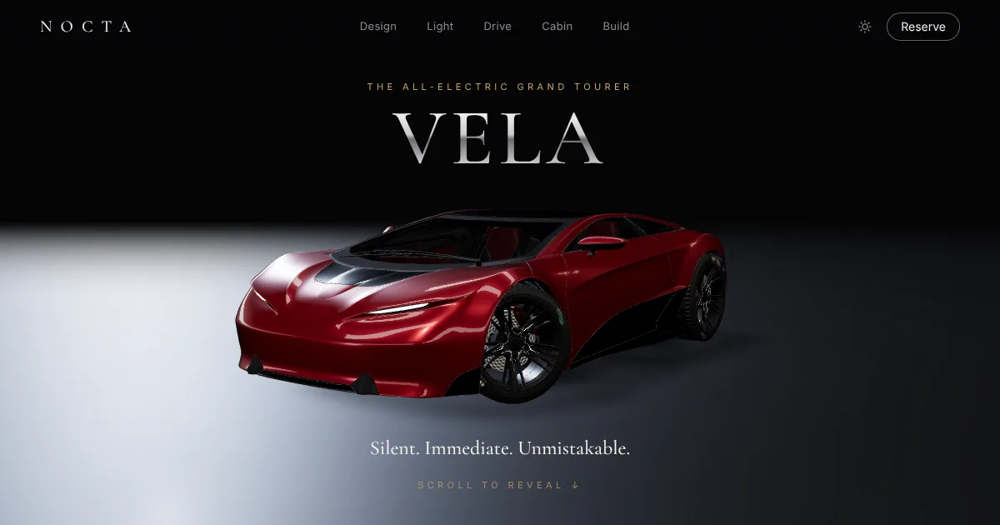

# NOCTA VELA — 3D Electric Car Configurator

A cinematic launch page for a fictional all-electric grand tourer, built around a real-time 3D car.

**Live:** [nocta-vela.vercel.app](https://nocta-vela.vercel.app) · Part of my [portfolio](https://aya-khamaysa-portfolio.vercel.app)



## Highlights

- **Film-like scroll:** the camera moves between shots: hero, side profile, night light signature, low rear, cabin with butterfly doors open, configurator, reservation.
- **Live configurator:** paint (gloss and matte), roof & mirrors, wheel finish, brake calipers and interior, all combinable, with a live price.
- **Showroom:** studio light strips, real headlight beams at night, doors and lights toggles, drag to turn.
- **Dark / light showroom** switch, and a WhatsApp reservation that sends the full build.

## Performance
- 3D model compressed from **11.8 MB to 3.3 MB** (texture resize, WebP, Meshopt).
- On-demand rendering: the scene only redraws when something moves.
- three.js loads in its own chunk after the text, with a still image for devices without WebGL.
- Lighthouse: **100** Accessibility, **100** Best Practices, **100** SEO.

## Built with

React · Three.js · React Three Fiber · drei · Framer Motion · Tailwind CSS · Vite

## Run locally

```bash
npm install
npm run dev
```

## Edit
- Choices, prices, WhatsApp number: `src/data/car.js`
- Texts: `src/data/ui.js`
- Camera shots and mood per section: `src/components/Stage.jsx` (`SHOTS`)
- Materials, doors and lights: `src/components/Car.jsx`

## Credits
- 3D car model: "Car Concept" by Eric Chadwick / Darmstadt Graphics Group, based on a public-domain model by Unity Fan. Licensed **CC BY 4.0**. Source: KhronosGroup/glTF-Sample-Assets. Logos on the plate and steering wheel are hidden.
- NOCTA and VELA are fictional names for a portfolio concept.

---

Designed & built by **Aya Khamaysa** · [Portfolio](https://aya-khamaysa-portfolio.vercel.app) · [LinkedIn](https://www.linkedin.com/in/ayakhamaysa) · [One Click](https://www.instagram.com/oneclick.ps)
